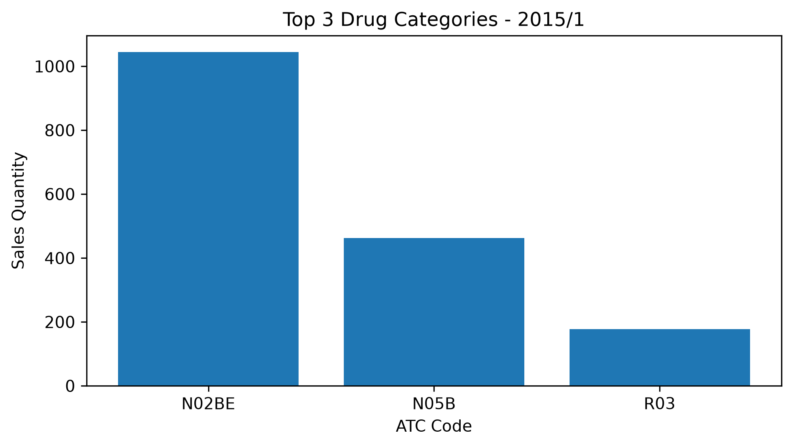
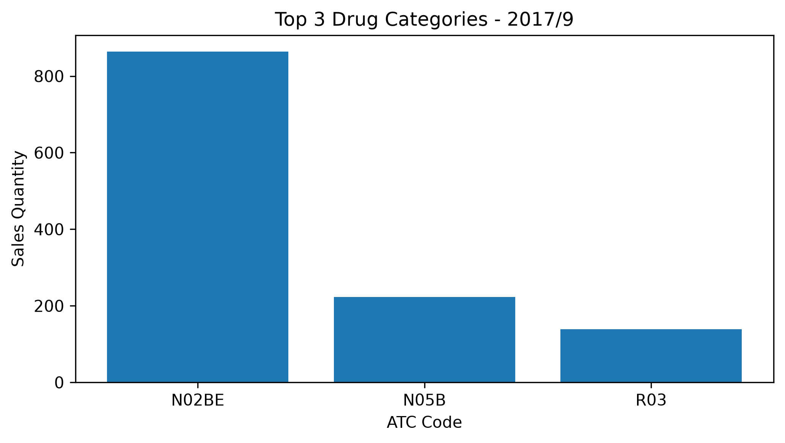
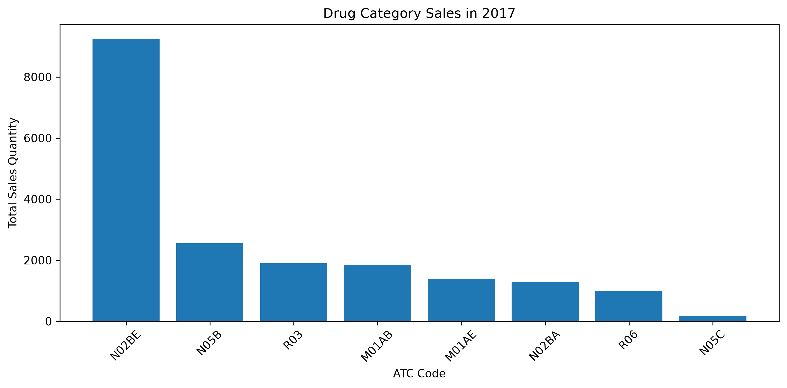
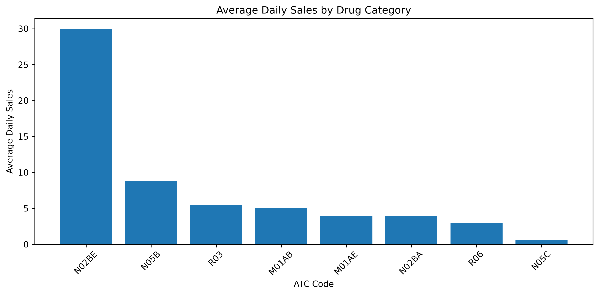

# Pharmaceutical Sales Analysis

## About the Project

This project focuses on analyzing daily pharmaceutical sales data to understand sales patterns across different drug categories (ATC codes).

The main goal is to identify top-selling drug categories, compare sales across selected months, understand yearly sales performance, and explore seasonal trends in respiratory drug sales.

The analysis was performed using Python, Pandas, and Matplotlib.

## How to Run the Project

### 1. Clone the repository

```bash
git clone <repository-url>
cd pharma-sales-analysis
```

### 2. Install uv

If uv is not already installed:

```bash
curl -LsSf https://astral.sh/uv/install.sh | sh
```

### 3. Create a virtual environment

```bash
uv venv
```

### 4. Lock and install dependencies

```bash
uv lock
uv sync
```

- `uv lock` generates or updates the dependency lock file.
- `uv sync` installs the project dependencies into the virtual environment.

### 5. Run the notebook

Open `pharma_sales_analysis.ipynb` in VS Code or Jupyter Notebook.

Select the Python interpreter from the project's `.venv` environment and run the notebook cells.

## Visualizations

### 1. Total Sales by Drug Category


N02BE recorded the highest total sales, followed by N05B and R03. N05C had the lowest total sales.

### 2. Top Three Drug Categories in Selected Months

**January 2015**



**July 2016**


**September 2017**



N02BE ranked first in all three selected months, while N05B ranked second. The third position changed depending on the month.

### 3. Drug Category Sales in 2017



N02BE was the highest-selling drug category in 2017, with total sales of approximately 9,258.80.

### 4. Average Daily Sales by Drug Category



N02BE had the highest average daily sales at approximately 29.92, making it the leading category in average daily sales as well.

### 5. Monthly Sales of Respiratory Drugs (R03)


R03 sales showed noticeable monthly variation.

- December recorded the highest average daily sales at approximately 7.92.
- October followed with approximately 7.21.
- July recorded the lowest average daily sales at approximately 2.96.

This suggests a seasonal pattern, with higher respiratory drug sales towards the colder months.

## Business Questions & Findings

| Business Question | Finding |
|---|---|
| What are the total sales quantities for each drug category? | N02BE had the highest total sales (63,005.40), while N05C had the lowest (1,249.96). |
| Which individual drug brands have the highest total sales? | Individual brand information is not available in the dataset. |
| Which three drugs have the highest sales in January 2015? | N02BE (1,044.24), N05B (463.00), R03 (177.25). |
| Which three drugs have the highest sales in July 2016? | N02BE (652.36), N05B (240.00), M01AB (194.53). |
| Which three drugs have the highest sales in September 2017? | N02BE (863.75), N05B (223.00), R03 (139.00). |
| Which drug has sold the most often in 2017? | N02BE, with approximately 9,258.80 in total sales. |
| Which drug category has the highest average daily sales? | N02BE, with approximately 29.92 average daily sales. |
| Are respiratory drugs (R03) sold more during specific months? | Yes. December and October recorded the highest average daily sales. |

## Conclusion

The analysis shows that N02BE consistently performed better than the other drug categories in terms of total sales, selected monthly sales, and average daily sales.

Respiratory drug sales (R03) also showed monthly variations, with higher average sales in October and December and lower sales during July and August.

Overall, this project helped identify important sales patterns and trends in pharmaceutical data using Python.