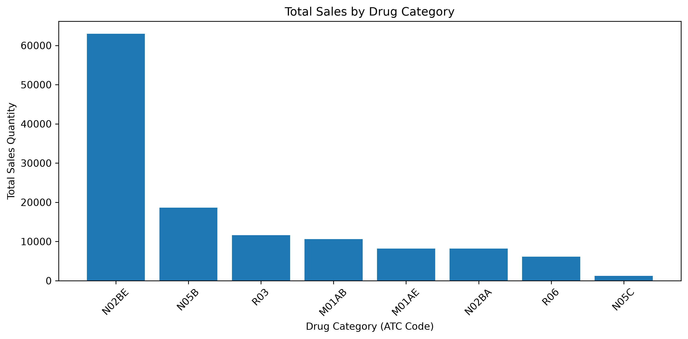
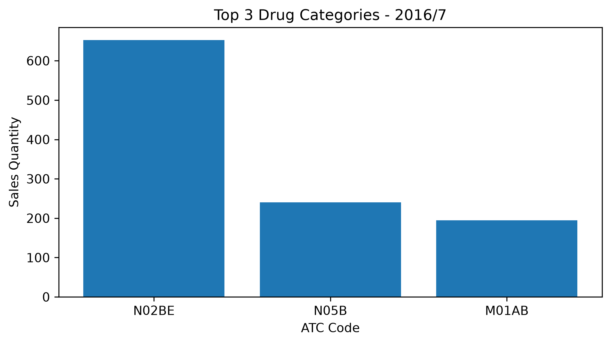
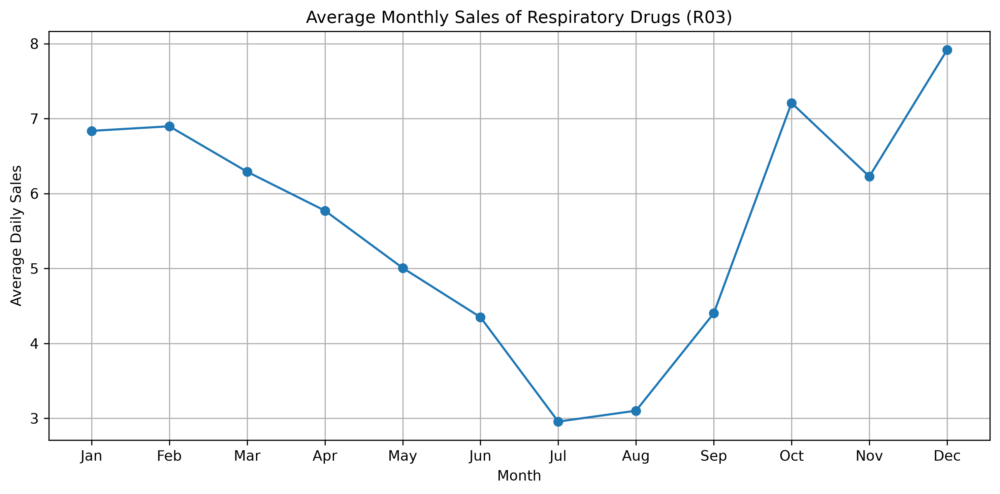

# Pharmaceutical Sales Analysis

## About

This project analyzes daily pharmaceutical sales data to understand sales patterns across different drug categories. The analysis uses Python, Pandas, and Matplotlib to answer business questions and present the findings through visualizations.

## Project Reference

This project is based on the [Pharmaceutical Sales Data project](https://roadmap.sh/projects/pharmaceutical-sales-data) from roadmap.sh.

## How to Run

### 1. Clone the repository

```bash
git clone <repository-url>
cd pharma-sales-analysis
```

### 2. Set up the environment

This project uses `uv` for Python environment and dependency management.

```bash
uv venv
uv lock
uv sync
```

### 3. Run the notebook

Open `pharma_sales_analysis.ipynb` in VS Code or Jupyter Notebook.

Select the project's `.venv` Python interpreter and run the notebook cells.

---

## Analysis and Findings

### 1. Which drug category has the highest total sales?

**Findings:**

N02BE recorded the highest total sales, with approximately **63,005.40**, making it the leading category in the dataset.

**Visualization:**



### 2. Which individual drug brands have the highest sales?

**Findings:**

The dataset contains sales information for ATC drug categories rather than individual brand names. Therefore, individual drug brands cannot be identified from the available data.

**Visualization:**

Not available because the dataset does not contain individual brand-level sales information.

### 3. Which drug categories had the highest sales in January 2015, July 2016, and September 2017?

**Findings:**

- **January 2015:** N02BE, N05B, and R03 were the top three categories.
- **July 2016:** N02BE, N05B, and M01AB were the top three categories.
- **September 2017:** N02BE, N05B, and R03 were the top three categories.

N02BE ranked first in all three selected months.

**Visualization:**





### 4. Which drug category had the highest sales in 2017?

**Findings:**

N02BE had the highest sales in 2017, with approximately **9,258.80**. N05B ranked second, followed by R03.

**Visualization:**


### 5. Which drug category has the highest average daily sales?

**Findings:**

N02BE had the highest average daily sales at approximately **29.92**, considerably higher than the other categories.

**Visualization:**


### 6. During which months are R03 sales highest?

**Findings:**

December had the highest average daily R03 sales at approximately **7.92**, followed by October at **7.21**. July recorded the lowest average at approximately **2.96**.

This indicates variation in R03 sales across the months.

**Visualization:**



---

## Conclusion

The analysis shows that N02BE consistently leads sales across the dataset, including in total sales, average daily sales, and the selected monthly comparisons. R03 sales also vary across the year, with the highest average daily sales recorded in December.

The dataset supports category-level analysis, but does not provide individual drug brand information.